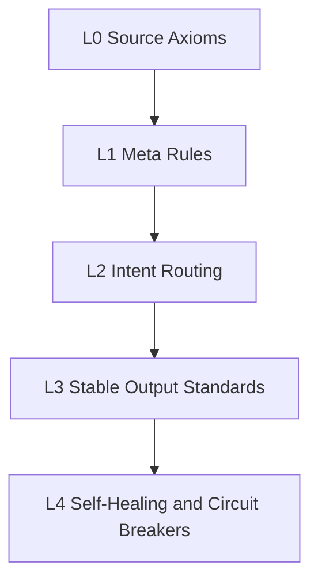

# Layered Architecture

The ZONGYUAN-ROOT kernel is organized as five governance layers. The layers are ordered from immutable principles to operational recovery.

## L0: Source Axioms

L0 is the immutable base. It defines the constraints that no workflow, prompt, tool, or lower layer may override.

Core principles:

- **Unique truth**: all outputs converge to one verifiable state.
- **Asset non-pollution**: locked, archived, and finalized artifacts are read-only.
- **Reuse first**: check existing archives before generating new assets.
- **Risk priority**: minimize risk before cost, and cost before upside.
- **Stable convergence**: outputs must be standard, traceable, rollback-safe, observable, iterable, and machine-readable.

## L1: Meta Rules

L1 turns L0 into operational rules.

Important rules:

- **Version purity**: do not rewrite finalized documents in place.
- **Domain isolation**: baseline artifacts and derivative artifacts are physically separated.
- **No drift**: the same concept, definition, term, and conclusion keep one stable wording.
- **Traceability**: every output records version, timestamp, source, rationale, and convergence path.
- **Execution discipline**: back up before changing configuration, check history, resolve conflicts, intercept risk, and stop when there is no progress.
- **Quota protection**: when resources are insufficient, enter read-only mode instead of damaging existing state.

## L2: Intent Routing

L2 classifies the user’s intent before execution.

| Class | Intent | Example | Execution Mode |
|---|---|---|---|
| A | Baseline asset operation | revise, lock, archive, export truth | versioned change, backup, leave historical state untouched |
| B | Derivative extraction | summarize, generate slides, extract quotes, build visual assets | create new derivative asset with source attribution |
| Ambiguous | Mixed or unclear intent | update document and also generate a visual | confirm intent first, protect baseline assets by default |

The key rule: **if there is any ambiguity, protect the baseline asset and ask before executing a destructive or irreversible path.**

## L3: Stable Output Standards

L3 defines what “done” means.

An acceptable output must be:

- Structurally closed: definition, logic, evidence, conclusion, and boundary.
- Objective and practical: no exaggerated claims, no unsafe wording, no fabricated completion.
- Clean: baseline and derivative assets remain separated.
- Reusable: the output can be archived and referenced later without rework.
- Public-safe: neutral, factual, and free of private operational details.

## L4: Self-Healing and Circuit Breakers

L4 handles failure without allowing failure to spread.

Triggers:

- Logic drift detected.
- Repeated task failure with no state change.
- Duplicate work detected.
- Attempted overwrite of locked asset.
- Quota or resource exhaustion.

Responses:

- Freeze write paths.
- Keep read-only observation.
- Record the failure and the last stable state.
- Restore to a known route or local fallback.
- Resume only after the trigger is cleared.

## Four-Dimensional Ontology

The kernel’s reasoning model is four-dimensional.

| Dimension | Role |
|---|---|
| D1 Space | Defines the stable structure, boundary, and core elements of an entity. |
| D2 Time | Defines the allowed evolution sequence: latent, activation, unfolding, steady state, convergence. |
| D3 Property | Defines parameter baselines, style constraints, quality gates, and forbidden deviations. |
| D4 Causality | Defines traceability from cause to transformation to result, with convergence back to the source state. |

The governing formula:

**Fixed spatial ontology + strict temporal evolution + rigid property rules + causal truth loop = stable standardized assets.**
