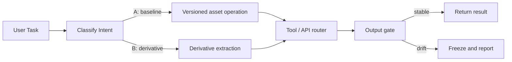

# Agent Runtime Model

The agent runtime is the execution layer below the governance kernel. It receives tasks, routes intent, calls tools or APIs, and returns controlled outputs.

## Execution Loop



## Intent Classification

Before calling expensive tools, classify the request.

A short practical prompt:

```text
Classify the task into one of:
A. Baseline update: modifies a formal, locked, or archived asset.
B. Derivative extraction: creates a new artifact from an existing asset.
C. Runtime operation: health check, probe, routing, monitoring, or fallback.
If ambiguous, default to read-only and ask for confirmation.
```

For baseline work, the runtime must not edit in place unless the task explicitly creates a new version.

For derivative work, the runtime must label the output as a derivative and record the source asset.

For runtime operation, the runtime should minimize external calls and prefer cached or reused probes.

## Tool Call Discipline

The runtime follows the same L1 rules:

- Back up configuration before changing it.
- Query history before overwriting state.
- Resolve conflicts before advancing.
- Prefer existing archived assets before generating new ones.
- Stop if the task repeats without progress.
- Keep private identifiers out of public artifacts.

## Local Fallback Pattern

When external APIs are unavailable or quota-restricted, the runtime can switch to a local fallback service.

A minimal fallback contract:

```http
GET /health
```

Returns:

```json
{
  "status": "ok",
  "model": "local",
  "capability": "text"
}
```

The router should only activate fallback when the external route is unavailable, not for convenience. This preserves quota and avoids unnecessary local load.

## Low-Consumption Keepalive

For scheduled checks, the runtime should:

1. Use a recent probe result if it is fresh.
2. Refresh the probe only after the freshness window expires.
3. Apply cooldowns to quota-sensitive providers.
4. Prefer free or low-cost public gateways for routine checks.
5. Report one-line status in normal states.
6. Expand diagnostics only when the route is degraded, local fallback is active, or repeated failures are detected.

## Public Output Rule

Public documentation and public repositories should contain only:

- Architecture concepts.
- Sanitized examples.
- Machine-readable schemas.
- Operational principles.
- Reproducible local workflows.

They should not contain:

- Access tokens.
- SSH keys.
- Private hostnames.
- Private endpoints.
- User-specific credentials.
- Unsanitized operational state.
